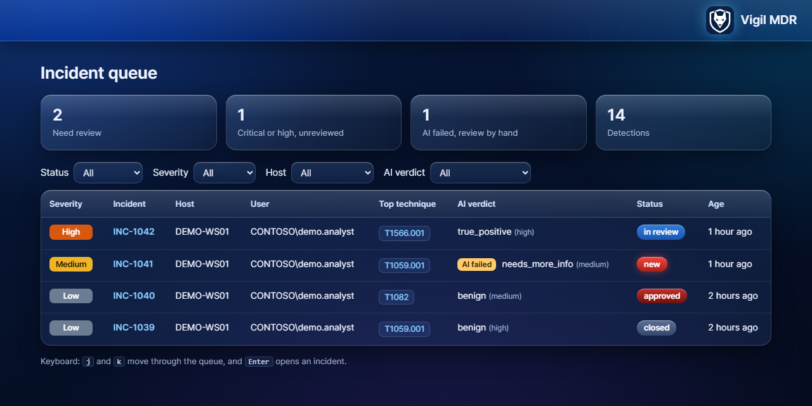
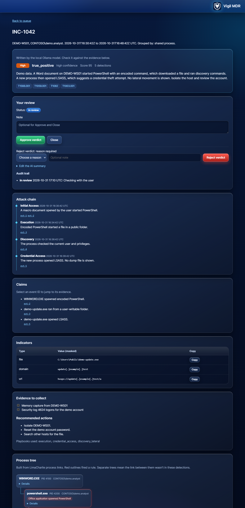
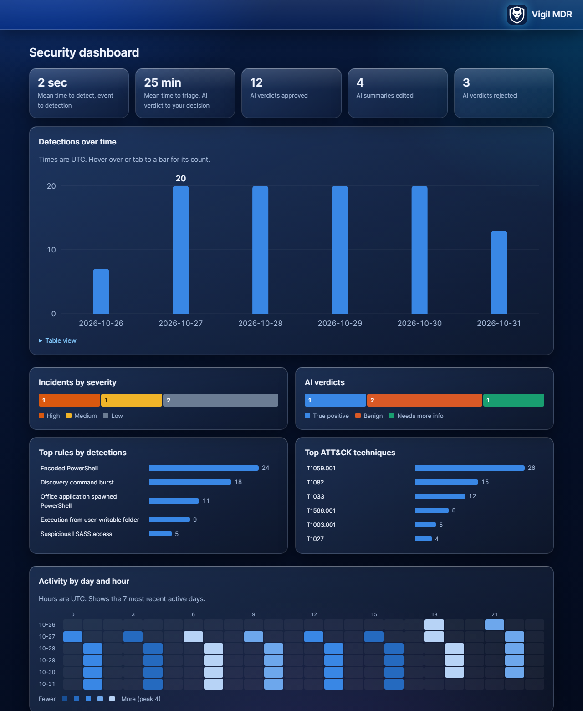
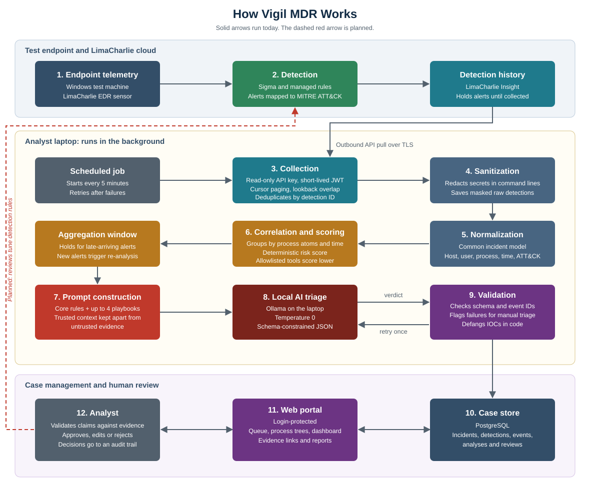

# 🛡️ Vigil MDR

### A personal Managed Detection and Response lab, built end to end.

**From raw endpoint telemetry to an analyst decision.**

> **This is a showcase.** The source code is private. Every screenshot uses invented demo data.

---

## 🎯 What it does

Vigil watches a test endpoint, pulls in detections automatically, connects related alerts into
incidents, asks a local AI model for a first opinion, and gives an analyst one place to review it all.

The AI assists. A person makes the final decision.

## 🖥️ Incident queue

Critical work first, with failed AI analysis flagged for manual review.

## 🔍 Incident investigation

The verdict, attack chain, indicators and process tree sit together. Each AI claim links back to
the evidence behind it, so nothing has to be taken on trust.

## 📊 Security dashboard

Detection trends, severity, AI review results, top rules and activity patterns.

## 🧭 How it works

## 🪜 Step by step

1. **Endpoint telemetry collection:** the LimaCharlie EDR sensor streams host telemetry, including process creation, parent-child relationships, command lines, file hashes and cross-process access events.
2. **Detection and TTP mapping:** Sigma and managed Detection & Response rules evaluate the event stream. Matches generate detections tagged with MITRE ATT&CK tactics and technique IDs.
3. **Alert ingestion:** a scheduled collector authenticates with a least-privilege, read-only API key, exchanges it for a short-lived JWT, and polls detection history over TLS. Cursor pagination and a lookback overlap prevent missed events, and detection IDs provide idempotent deduplication.
4. **Data sanitization:** credential material in command-line arguments, such as tokens and passwords, is redacted before storage or LLM processing. This limits secret exposure in downstream systems.
5. **Normalization:** vendor-specific detection schemas, including stateful multi-event detections, are parsed into a common incident model with host, user, process lineage, timestamps and ATT&CK context.
6. **Event correlation:** detections are clustered per host using process atoms, which are unique identifiers that avoid PID reuse, and a bounded time window for related activity. This reduces alert fatigue by turning many alerts into one incident.
7. **Risk scoring:** a deterministic model weighs rule severity, technique diversity, rule diversity and sensitive targets such as LSASS. Allowlisted tooling reduces the score without suppressing the alert.
8. **Aggregation window:** incidents are held briefly after their last detection, so late-arriving alerts join before triage. New detections trigger re-analysis.
9. **Context-aware prompt construction:** core DFIR instructions are combined with up to four playbooks selected by ATT&CK technique, which keeps the prompt inside the small model's context limit.
10. **Local LLM inference:** a small model on Ollama performs triage at temperature 0 with schema-constrained JSON output. Inference stays on the host, so telemetry isn't sent to a third-party AI service.
11. **Output validation:** responses are checked against the schema, and every cited event ID is verified against the evidence to catch hallucinated references. Failures get one corrective retry, then the incident is flagged for manual triage.
12. **IOC defanging:** IPs, domains, URLs and email addresses in AI output are defanged in code, which prevents accidental clicks or resolution of malicious indicators.
13. **Case management:** incidents, evidence, analyses and analyst decisions persist in PostgreSQL, with process trees and evidence-linked timelines for investigation.
14. **Analyst triage and disposition:** a human validates each claim against raw telemetry, then approves, edits or rejects the verdict with a reason code such as false positive. Every action is written to an audit trail.

## 🤖 How the AI model works

- **Runs locally:** the model runs through Ollama, so detection data stays on the machine.
- **Picks the right guidance:** a small local model can't hold everything at once, so it only gets playbooks relevant to the incident.
- **Separates trust levels:** trusted context from Vigil stays apart from evidence, which may contain text written by an attacker.
- **Treats evidence as data:** instructions hidden in logs are never followed, and attempts to steer the AI count as suspicious.
- **Must show its work:** every claim has to cite event IDs from the evidence.
- **Returns a fixed format:** verdict, confidence, severity, summary, attack chain, claims, indicators, evidence to collect and recommended actions.
- **Stays deterministic where it counts:** scoring, grouping, timelines, masking and defanging are done by code, not by the model.
- **Doesn't get the last word:** its verdict is a starting point for a person, not an automatic action.

## ✨ Highlights

- **Automated collection:** pulls detections from LimaCharlie every 5 minutes, and catches up after downtime
- **Correlation:** groups alerts by process links and time into scored incidents
- **Local AI triage:** runs on Ollama, so detection data doesn't go to an outside AI service
- **Playbook-driven analysis:** picks investigation guidance from MITRE ATT&CK techniques
- **Output validation:** rejects evidence references the AI made up
- **IOC defanging and secret masking:** handled in code, not left to the model
- **Process trees:** built from real parent and child links
- **Analyst workflow:** approve, edit or reject, with reasons and an audit trail
- **Customer reports:** clean PDFs without raw events, available only after review

## 🧰 Tech stack

| Area | Tools |
|---|---|
| Detection | LimaCharlie, Sigma, MITRE ATT&CK |
| Pipeline | Python, Windows Task Scheduler |
| AI | Ollama, running locally |
| Storage | PostgreSQL |
| Portal | FastAPI, Jinja, HTMX |

## 🔐 Security by design

- Attacker-controlled text is kept apart from trusted context, and escaped on every page
- Portal login with hashed passwords, signed sessions, lockouts and cross-site protection
- Least-privilege, read-only access to detection data
- Secrets stay out of the code

## 🚧 Honest status

This is a working lab project, not a production security service. It doesn't block attacks.

The pipeline runs end to end, but AI verdicts are still unreliable and accuracy hasn't been
measured, which is exactly why a person reviews every incident. Next up: code-based guardrails,
an evaluation set, rule tuning, and a feedback loop from analyst decisions.

---

Built by [Sunil Chikkala](https://github.com/sunilnaidu265)

